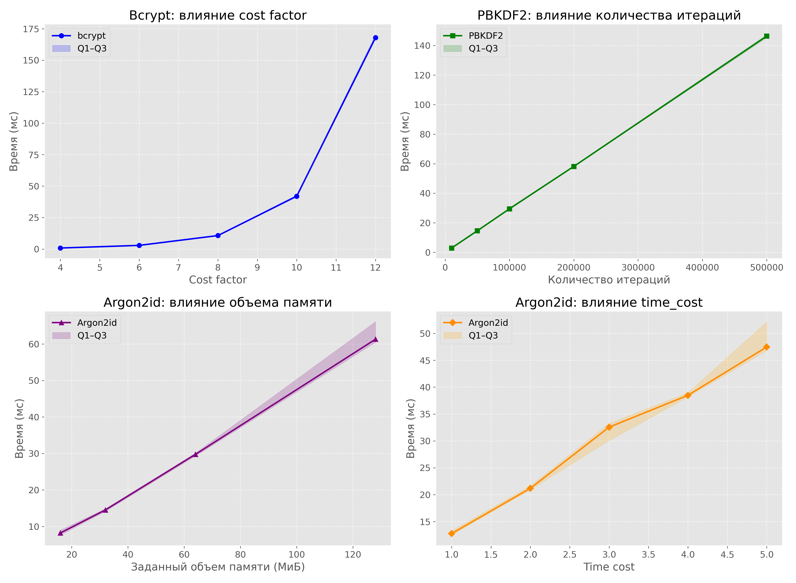
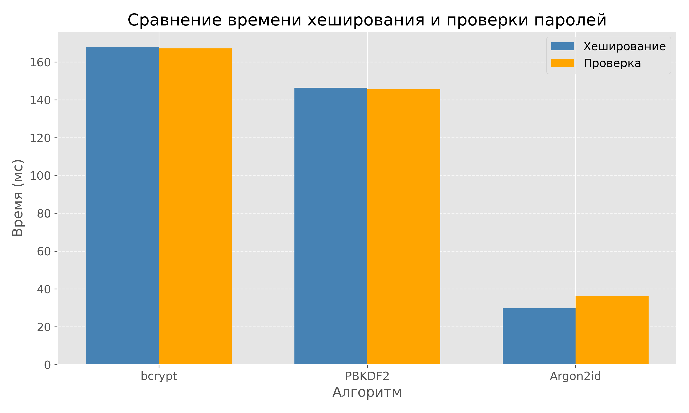
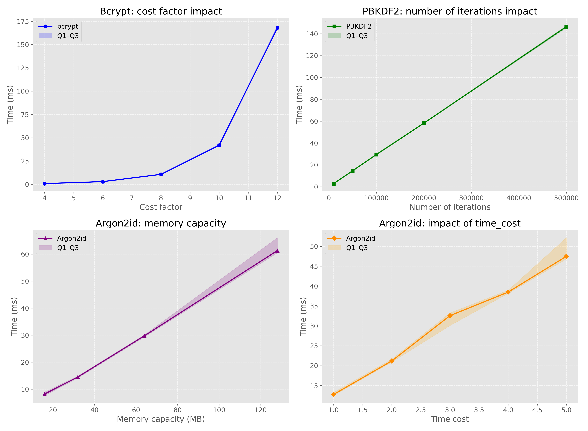
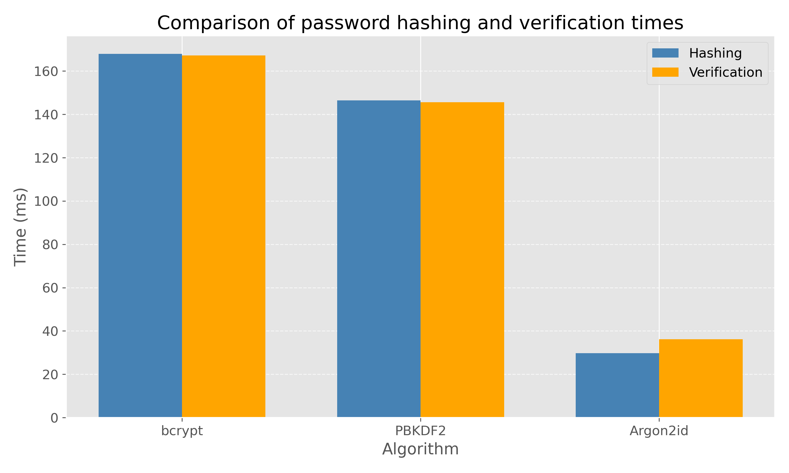

# Экспериментальное исследование влияния параметров алгоритмов хранения паролей на вычислительные затраты
## Описание
Данный репозиторий является курсовой работой по предмету "Основы разработки защищённого программного обеспечения и компьютерных сетей". (тип работы: КР-НИ, аналитико-исследовательская).

Целью работы является экспериментальное исследование влияния параметров алгоритмов хранения паролей (bcrypt, PBKDF2, Argon2) на вычислительные затраты (время выполнения и потребление оперативной памяти), а также определение оптимальных конфигураций, обеспечивающих баланс между безопасностью и производительностью системы.

Актуальность исследования обусловлена тем, что неправильный выбор параметров хеширования (например, слишком низкое количество итераций или малый объем памяти) делает систему уязвимой к атакам перебора. С другой стороны, завышенные параметры приводят к недопустимым задержкам при аутентификации пользователей.

В рамках работы были решены следующие задачи:
*   Реализован программный стенд на Python для замера времени и памяти.
*   Проведена серия замеров для трех алгоритмов с различными параметрами (Cost Factor, Iterations, Memory Cost).
*   Выполнена статистическая обработка данных (расчет медианы) для исключения фоновых шумов ОС.
*   Построены графики зависимостей вычислительных затрат от параметров.

Структура репозитория:
*   `experiments/` — Jupyter Notebook с основным кодом исследования, скрипты и папки с результатами (CSV) и графиками (PNG).
*   `report/` — итоговая пояснительная записка и презентация к защите.
*   `requirements.txt` — список необходимых библиотек для воспроизведения эксперимента.

Методология экспериментов, описание аппаратной среды и версии используемых библиотек подробно описаны в [methodology.md](experiments/methodology.md).
## Результаты

В ходе эксперимента исследовано влияние вычислительных параметров алгоритмов bcrypt, PBKDF2-HMAC-SHA256 и Argon2id на время хеширования паролей. Дополнительно проведено сравнение времени создания и проверки парольных хешей и выполнен статистический анализ разброса измерений.

Для исследования использовался набор из 1000 сгенерированных паролей. Основной эксперимент включал 19 конфигураций алгоритмов, для каждой из которых выполнялось 100 повторных измерений. В качестве основной оценки времени использовалась медиана.

### Влияние параметров на время хеширования
По результатам эксперимента установлены следующие зависимости:

* bcrypt: увеличение параметра cost с 4 до 12 привело к росту медианного времени хеширования с 0,684 до 168,207 мс (приблизительно в 246 раз), что соответствует экспоненциальному характеру зависимости.

* PBKDF2: увеличение числа итераций с 10 000 до 500 000 привело к росту времени с 2,644 до 132,022 мс (приблизительно в 50 раз). Зависимость близка к линейной.

* Argon2id: увеличение параметра memory_cost с 16 до 128 МиБ привело к росту времени с 8,610 до 61,519 мс (приблизительно в 7,1 раза).

* Argon2id: увеличение параметра time_cost с 1 до 5 при фиксированном объёме памяти 64 МиБ привело к росту времени с 14,170 до 55,652 мс (приблизительно в 3,9 раза).



### Сравнение времени хеширования и проверки паролей

Для сравнения выбраны следующие конфигурации: bcrypt (cost=12), PBKDF2-HMAC-SHA256 (500 000 итераций) и Argon2id (memory_cost=64 МиБ, time_cost=3, parallelism=4).

| Алгоритм | Хеширование, мс | Проверка, мс |
 :--- | :---: | ---: |
| bcrypt | 168.27 | 168.244 |
| Argon2id | 32.591 | 36.638 |
| PBKDF | 132.022 | 133.956 |



### Статистический анализ

Для оценки стабильности результатов рассчитаны стандартное отклонение, первый и третий квартили (Q1–Q3), а также коэффициент вариации.

Для выбранных конфигураций коэффициент вариации составил:

* bcrypt (cost=12) — 1,28%;

* PBKDF2 (500 000 итераций) — 5,72%;

* Argon2id (64 МиБ, time_cost=3) — 7,41%.

В исследованных условиях наименьший относительный разброс времени наблюдался у bcrypt. Для Argon2id и PBKDF2 колебания времени были более заметными

## Установка
1. Склонируйте репозиторий
```
git clone https://github.com/mosheadd/KR-NI-02.git
```
2. Зайдите в корневую папку
```
cd ../KR-NI-02
```
3. Установите нужные библиотеки
```
pip install -r requirements.txt
```
4. Запустите код
* С воспроизводимостью полученных результатов:
```
python run.py
```
* Можно выставить свой seed:
```
python run.py --seed 'число'
```
* Случайный seed:
```
python run.py --random
```

# Experimental research of impact of password-hashing alogorithms on computational cost.
## Description
This repository contains a term project for the course "Fundamentals of Developing Secure Software and Computer Networks" (project type: analytical-research term project).

The objective of this work is to experimentally investigate the impact of parameters for password-hashing algorithms (bcrypt, PBKDF2, Argon2) on computational costs (execution time and RAM usage), as well as to determine optimal configurations that provide a balance between security and system performance.

The relevance of this research stems from the fact that an improper choice of hashing parameters—such as an insufficient number of iterations or an inadequate amount of memory—renders a system vulnerable to brute-force attacks. Conversely, setting these parameters too high results in unacceptable delays during user authentication.

The following tasks were completed as part of this work:
*   A software testbed was implemented in Python to measure execution time and memory usage.
*   A series of measurements was conducted for three algorithms using various parameters (Cost Factor, Iterations, and Memory Cost).
*   Statistical data processing (calculation of the median) was performed to filter out background OS noise.
*   Graphs illustrating the dependence of computational costs on the parameters were generated.

Repository structure:
*   `experiments/` — Jupyter Notebook containing the core research code, scripts, and folders with results (CSV files) and plots (PNG images).
*   `report/` — final explanatory report and presentation for the defense.
*   `requirements.txt` — a list of the libraries required to reproduce the experiment.

The experimental methodology, description of the hardware environment and versions of the libraries used are described in detail in [methodology.md](experiments/methodology.md).
## Results

The experiment investigated the impact of computational parameters for the bcrypt, PBKDF2-HMAC-SHA256, and Argon2id algorithms on password hashing time. Additionally, the time required to generate and verify password hashes was compared, and a statistical analysis of the variance in measurements was performed.

A set of 1,000 generated passwords was used for the study. The main experiment encompassed 19 algorithm configurations, with 100 repeated measurements conducted for each. The median value was used as the primary metric for time.

### The impact of parameters on hashing time

The experimental results reveal the following relationships:

* bcrypt: increasing the `cost` parameter from 4 to 12 caused the median hashing time to rise from 0.684 ms to 168.207 ms (an increase of approximately 246 times), which corresponds to an exponential relationship.

* PBKDF2: increasing the number of iterations from 10,000 to 500,000 caused the time to rise from 2.644 ms to 132.022 ms (an increase of approximately 50 times). The relationship is nearly linear.

* Argon2id: increasing the `memory_cost` parameter from 16 MiB to 128 MiB caused the time to rise from 8.610 ms to 61.519 ms (an increase of approximately 7.1 times).

* Argon2id: increasing the `time_cost` parameter from 1 to 5, with the memory usage fixed at 64 MiB, caused the time to rise from 14.170 ms to 55.652 ms (an increase of approximately 3.9 times).



### Comparison of password hashing and verification times

The following configurations were selected for comparison: bcrypt (cost=12), PBKDF2-HMAC-SHA256 (500,000 iterations), and Argon2id (memory_cost=64 MiB, time_cost=3, parallelism=4).

| Algorithm | Hashing, ms | Verification, ms |
 :--- | :---: | ---: |
| bcrypt | 168.27 | 168.244 |
| Argon2id | 32.591 | 36.638 |
| PBKDF | 132.022 | 133.956 |



### Statistical analysis

To assess the stability of the results, the standard deviation, the first and third quartiles (Q1–Q3), and the coefficient of variation were calculated.

For the selected configurations, the coefficient of variation was as follows:

* bcrypt (cost=12) — 1.28%;

* PBKDF2 (500,000 iterations) — 5.72%;

* Argon2id (64 MiB, time_cost=3) — 7.41%.

Under the conditions studied, bcrypt exhibited the lowest relative variation in execution time, whereas the fluctuations in time were more pronounced for Argon2id and PBKDF2.

## Installation
1. Clone the repository
```
git clone https://github.com/mosheadd/KR-NI-02.git
```
2. Head to the root folder
```
cd ../KR-NI-02
```
3. Install the required libraries
```
pip install -r requirements.txt
```
4. Run the code
* To replicate the shown results:
```
python run.py
```
* Set a seed:
```
python run.py --seed 'number'
```
* Random seed:
```
python run.py --random
```